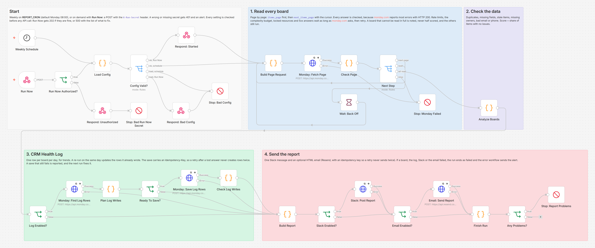
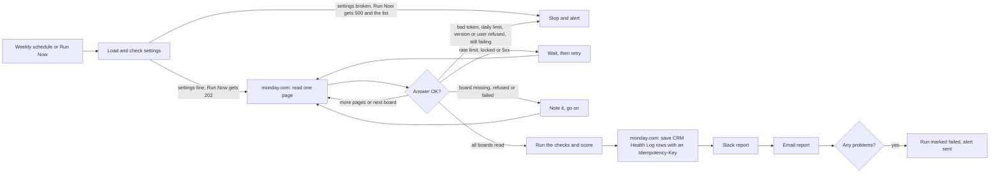

# Monday.com CRM Health Report: n8n + Slack + Email

A weekly check of your monday.com CRM boards. It finds duplicate contacts, missing fields, stale deals, items without an owner and bad emails or phone numbers, scores each board from 0 to 100, and sends one short report to Slack and email with links to the worst items. Built with n8n.



## The problem

CRM data gets worse a little every week. Imports and web forms create the same contact twice, reps skip fields when they are busy, deals sit untouched for months, and contacts lose their owner when someone leaves. Nobody notices until a campaign bounces or a hot lead goes cold. Checking by hand means filtering every board one by one, so in practice it does not happen.

## What this does

1. **Reads every item on every board you list**, page by page, so a board with 10,000 items is checked in full, not just the first page.
2. **Finds duplicate contacts** that share an email (case and surrounding spaces ignored) or a phone number (formatting ignored). It also catches chains: if A and B share a phone and B and C share an email, all three are one contact. Placeholders such as `n/a` count as invalid, so they never turn unrelated contacts into "duplicates".
3. **Flags the other common problems:** empty required fields, stale items (not in a done status and not updated for 30 days), items with no owner, and emails or phone numbers that cannot be right.
4. **Scores each board from 0 to 100:** the share of items with no issues.
5. **Lists the worst items with direct links**, so someone can fix them in a few minutes.
6. **Sends one Slack message and an optional HTML email.**
7. **Keeps a trend log** on a monday.com "CRM Health Log" board: one row per board per day. Running the report twice on the same day updates that row instead of adding a second one.
8. **Fails safely.** Rate limits, monday.com's complexity budget and temporary errors make it wait and retry. A board it cannot read in full is named in the report and never half scored, while the other boards still run. Any problem ends the run as failed, so the error workflow alerts you.

## How it works



Each page is one GraphQL request. The first page of a board uses `boards { items_page }`, which also returns the board name and confirms that every configured column exists. Every later page uses `next_items_page` with the cursor from the page before, as monday.com recommends. The pages are a loop on the canvas rather than the HTTP node's built in pagination, because the workflow has to look at each answer: monday.com reports most errors with HTTP 200 and an `errors` list, and when it hits a rate limit it says how many seconds to wait (`retry_in_seconds`), which can be longer than n8n's built in retry allows.

When all boards are read, one Code node puts the pages of each board back together and runs the checks, so a duplicate on page 1 and its copy on page 3 are still found.

## Workflow at a glance

| Step | Nodes | What it does |
|---|---|---|
| Start | Weekly Schedule, Run Now, Run Now Authorized?, Respond: Unauthorized, Stop: Bad Run Now Secret | Runs on `REPORT_CRON`, or on demand through a webhook protected by the `X-Run-Secret` header. A wrong or missing secret gets 401 |
| 1 | Load Config, Config Valid?, Respond: Started, Respond: Bad Config, Stop: Bad Config | Reads and checks every setting before any API call. Run Now gets 202 when they are fine (the report then arrives in Slack or email), or 500 with the list of what to fix |
| 2 | Build Page Request, Monday: Fetch Page | One request per page, with the `API-Version` header and the page size and column IDs as GraphQL variables |
| 3 | Check Page, Next Step, Wait: Back Off | Checks each answer and keeps the items. Next page, next board, wait and retry, or stop |
| 4 | Stop: Monday Failed | Bad token, daily call limit, an API version or user that monday.com refuses, or monday.com still failing after `MONDAY_MAX_TRIES` tries (default 3). No half report is sent; the error workflow alerts you |
| 5 | Analyze Boards | Runs the five checks across all pages of each board, scores it and picks the worst items |
| 6 | Log Enabled?, Monday: Find Log Rows, Plan Log Writes, Ready To Save?, Monday: Save Log Rows, Check Log Writes | Finds today's rows by their key, then updates or creates one row per board in a single request. The request carries an `Idempotency-Key`, so n8n can retry it without creating a row twice |
| 7 | Build Report, Slack Enabled?, Slack: Post Report, Email Enabled?, Email: Send Report | Builds and sends the Slack message and the HTML email |
| 8 | Finish Run, Any Problems?, Stop: Report Problems | Ends the run as failed if a board, the log, Slack or the email had a problem |

## The checks and the score

| Check | An item counts when |
|---|---|
| Duplicate | It shares a valid email or phone number with an older item on the same board. Emails are compared without case and surrounding spaces; phone numbers by their digits, with `PHONE_DEFAULT_COUNTRY_CODE` added when there is no country code. The oldest item in each group is the original and does not count. A value that is not a valid email or phone, such as `n/a`, is only counted as invalid |
| Missing required field | Any column in `required_columns` is empty |
| Stale | Its status is not one of `done_labels` and its `updated_at` is more than `STALE_DAYS` days ago. An item with no status can be stale |
| No owner | The owner column is empty |
| Invalid email or phone | The email does not look like `name@domain.tld`, or the phone number has letters or fewer than 8 or more than 15 digits, counting the country code |

**Health score = round(100 × items with no issues ÷ all items).** An item with three problems counts once, so the score answers one question: what share of the records can the team trust as they are? The counts per check show where the work is. Grades: 90 to 100 is Healthy, 75 to 89 is Fair, below 75 is Needs attention. An empty board gets no score.

In the test data, Sales Pipeline has 130 items and 19 of them have at least one issue, so 111 are clean: round(100 × 111 ÷ 130) = **85**, Fair.

The worst items are sorted by number of issues, then by how long they have gone without an update.

## What the team gets

How the Slack message from the test run reads (all data made up). The raw payload is in [docs/test-report.md](docs/test-report.md):

```
CRM health report, 2026-10-21
*3 of 3 boards checked*, 142 items, 19 with at least one issue.

:large_yellow_circle: *Sales Pipeline*: score *85/100* (Fair)
130 items, 19 with issues: 5 duplicates, 5 missing required fields, 5 stale, 4 without an owner, 3 with an invalid email or phone.
*Worst items*
• Morgan Diaz & Co <VIP>: duplicate of Jordan Lee, missing Company, no update in 60 days, no owner
• Blake Carter: missing Phone, Company
• Cameron Dalton: missing Email, Phone
• Noel Grant: invalid email, invalid phone
• Peyton Baker: no owner

:large_green_circle: *Partner Leads*: score *100/100* (Healthy)
12 items, no issues found.

:white_circle: *Old Imports*: empty board, nothing to check.

Score = share of items with no issues. Stale = not done and no update for more than 30 days. Health log: 3 new, 0 updated. Run by Run Now.
```

Board and item names are links to monday.com. The email has the same content as a table, with the subject `CRM health report 2026-10-21: lowest score 85/100 (Sales Pipeline)`. Names from the CRM are escaped in both, so an item called `<VIP>` cannot break the message or inject HTML into the email.

## Setup

**You need:** self-hosted n8n 2.x (tested on 2.19.5), a monday.com account and its API token, and at least one way to receive the report: a Slack incoming webhook, a Resend account for email, or both. The CRM Health Log board is optional.

1. Import `workflow/monday-crm-health-report.json` into n8n. For failure alerts, also import `workflow/error-alert-slack.json`.
2. Add the variables below to your n8n environment and restart n8n. The nodes read them with `$env`, so self-hosted n8n needs `N8N_BLOCK_ENV_ACCESS_IN_NODE=false`. (n8n Cloud does not allow `$env`. There, replace `$env.` with `$vars.` and create the same names under Variables.)
3. **Activate the error alert workflow.** n8n 2.x only calls an error workflow that is active; otherwise the alert is silently skipped. Then choose it as the **Error Workflow** in the report workflow's settings.
4. Activate the report workflow.
5. Run it once on demand to check the setup:
   `curl -X POST https://YOUR-N8N-DOMAIN/webhook/monday-crm-health-report -H "X-Run-Secret: YOUR_RUN_NOW_SECRET"`
   The answer is 202 when the settings are fine, or 500 with a `problems` list that says what to fix.

Step by step for monday.com (API token, board and column IDs, the log board), Slack and Resend: [docs/setup.md](docs/setup.md).

| Variable | Required | Where to find it |
|---|---|---|
| `MONDAY_API_TOKEN` | yes | monday.com → profile picture → Developers → API token → Show. The token sees what its user sees, so that user needs access to every board you list |
| `MONDAY_API_VERSION` | no | Default `2026-07`, the version this was tested against and the one monday.com serves by default (checked October 2026). Every request is also valid against `2026-10` and `2027-01` |
| `BOARDS_JSON` | yes | The boards to check, as one line of JSON (see below) |
| `STALE_DAYS` | no | Days without an update before an open item is stale. Default 30 |
| `MONDAY_PAGE_SIZE` | no | Items per request, 1 to 500. Default 100 |
| `MONDAY_MAX_PAGES` | no | Safety limit per board. Default 200 pages |
| `MONDAY_MAX_TRIES` | no | Tries per page when monday.com is busy or failing. Default 3 |
| `MONDAY_MAX_WAIT_SECONDS` | no | Longest single wait between tries. Default 60, which covers monday.com's one minute budget reset |
| `TOP_OFFENDERS` | no | Worst items listed per board. Default 5 |
| `PHONE_DEFAULT_COUNTRY_CODE` | no | Added to phone numbers that have no country code. Default `1` |
| `REPORT_TIMEZONE` | no | Time zone for the report date, for example `America/New_York`. Default: n8n's time zone |
| `REPORT_CRON` | no | When the weekly run starts, in n8n's time zone. Default `0 8 * * 1` (Monday 08:00). n8n reads it when the workflow is activated |
| `RUN_NOW_SECRET` | yes, for Run Now | Any long random string. Without it, Run Now refuses every call |
| `SLACK_WEBHOOK_URL` | one of Slack or email | A Slack incoming webhook. The error alert workflow uses the same one, so without it a failed run only shows in n8n's Executions list |
| `RESEND_API_KEY` | for email | resend.com → API Keys, with sending access |
| `REPORT_EMAIL_FROM` | for email | An address on a domain you verified in Resend, for example `CRM Reports <reports@example.com>` |
| `REPORT_EMAIL_TO` | for email | One or more addresses, separated by commas. Leave empty to skip email |
| `HEALTH_LOG_BOARD_ID` | no | The CRM Health Log board. Leave empty to skip the log |
| `HEALTH_LOG_COLUMNS` | with the log | Which column on the log board holds which number (see below) |
| `HEALTH_LOG_GROUP_ID` | no | The group new log rows go into. Default: the board's top group |

**BOARDS_JSON**, one entry per board:

```json
[
  {
    "id": "1234567890",
    "name": "Sales Pipeline",
    "required_columns": ["email", "phone", "text_company"],
    "email_column": "email",
    "phone_column": "phone",
    "status_column": "status",
    "owner_column": "person",
    "done_labels": ["Closed Won", "Closed Lost"]
  }
]
```

| Field | Meaning |
|---|---|
| `id` | The board ID from the board's URL |
| `name` | Optional. The name used in the report; default is the board's own name |
| `required_columns` | Column IDs that must not be empty |
| `email_column`, `phone_column` | Optional. Used for duplicates and format checks. Email or phone columns, or plain text columns |
| `status_column`, `done_labels` | Optional. Items with one of these labels are never stale. Labels are matched without case |
| `owner_column` | Optional. A people column. Leave it out to skip the owner check |

Leave out a check by leaving out its column. The report and email show "n/a" for checks that are not set up.

**HEALTH_LOG_COLUMNS** maps each number to a column ID on the log board. `key` must be a text column; the workflow writes `<date>|<board id>` into it and uses it to find the row again on a re-run. `date` must be a date column and `board` a text column; the rest are numbers columns. Leave out any you do not want.

```json
{"key": "text_key", "date": "date_snapshot", "board": "text_board", "score": "numbers_score", "items": "numbers_items", "issues": "numbers_issues", "duplicates": "numbers_dupes", "missing": "numbers_missing", "stale": "numbers_stale", "no_owner": "numbers_owner", "invalid": "numbers_invalid"}
```

**API usage:** one request per page plus two for the log. A 10,000 item board at the default page size is 100 requests. monday.com's Basic and Standard plans allow 1,000 API calls a day, so on those plans with big boards, raise `MONDAY_PAGE_SIZE` to 500.

## Testing

The workflow was tested end to end on n8n 2.19.5 against **mock monday.com, Slack and Resend APIs**, so no real account was touched. The mock monday.com API checks every request against monday.com's own published GraphQL schema (version 2026-07), so a misspelled field, a wrong argument type or an unused variable is rejected just like the real API rejects it. It also enforces the token, a served `API-Version` (an unknown one gets `InvalidVersionException` with HTTP 200, as monday.com answers), JSON variables, page limits and cursors, writes column values the way monday.com does (for a numbers column an empty string becomes 0 and `null` clears it), replays a mutation sent again with the same `Idempotency-Key`, and answers each error with the HTTP status monday.com uses for it (most with 200, `UserUnauthorizedException` with 403). The mock Slack enforces Block Kit limits, and the mock Resend enforces the `User-Agent` header, required fields and idempotency keys. Separately, all 224 monday.com requests the workflow sent in the final run were validated against the full published schemas for 2026-04, 2026-07, 2026-10 and 2027-01: all valid.

The test data has known problems planted on purpose (duplicates across pages, a chain of three, missing fields, stale and almost stale items, done items that are old but fine, bad formats, the same `n/a` placeholder on two items), so the test can assert exact numbers. To check that the checks themselves have teeth, nineteen deliberately broken copies of the workflow were run through the same test, and each one failed it.

All 60 checks across 36 scenarios pass:

| Scenario | Result |
|---|---|
| Run Now with a wrong or missing secret | 401, settings not even read, nothing sent, alert raised |
| Run Now with broken settings | 500 with the list of settings to fix, nothing read, alert raised |
| Full report, three boards | Sales Pipeline read in 3 pages through the cursor chain, then exact counts (5 duplicates in 3 groups, 5 missing fields, 5 stale, 4 without owner, 3 invalid), score 85 and the 5 worst items in order. The two `n/a` emails are invalid, not duplicates. Clean board scores 100, empty board gets no score. One Slack message, one email, 3 log rows with the exact numbers |
| Run again on the same day | The 3 log rows are updated, no new rows |
| A board emptied since the earlier run that day | Its log row is updated to 0 items and the old score is cleared, not kept and not turned into 0 |
| Complexity budget exhausted (429 with `retry_in_seconds`) | Waits, retries the same cursor, counts unchanged |
| Complexity budget low after a page | Keeps the page, then pauses for the budget reset before the next one instead of hitting the limit |
| monday.com answers 500, then 423 (resource locked) | Waits 10 seconds, then the 7 seconds monday.com asks for in `Retry-After`, then the report is complete |
| GraphQL error with HTTP 200, temporary (`API_TEMPORARILY_BLOCKED`) | Not mistaken for an empty board: waits, retries, report complete |
| A board refused with 403, and a board that no longer exists | Both named in the report as not checked, the third board still scored, run flagged |
| GraphQL error with HTTP 200, permanent (cursor expired on page 3) | Board named as not checked. The 100 items already read are not scored, and its log row keeps the last good numbers |
| A configured column was deleted from the board | Board flagged with the missing column ID, others still run |
| A required column is a formula column | Board flagged with the column ID instead of a score where every item looks incomplete |
| One page over the 5M complexity limit (`REQUEST_MAX_COMPLEXITY_EXCEEDED`) | Not retried. The board is named with the hint to lower `MONDAY_PAGE_SIZE`, the others still run |
| monday.com down, dropped connections, bad token, daily call limit | Run stops with an alert and no half report. Bad token and daily limit stop at once, without pointless retries |
| API version no longer served, or the token's user may not use the API | Stops at once with the reason, after one request |
| Health log lookup fails, or the save fails every time | The report and the email still go out and say the log was not saved. The save is tried 3 times with one `Idempotency-Key` and no row is touched |
| The save worked but its answer was lost | n8n retries with the same key and body, the mock monday.com answers from the first run, and there are 3 rows, not 6 |
| The log board's key column is missing (GraphQL error with HTTP 200) | Not retried, nothing written, the report names the missing column |
| One log row fails, then the next run | The next run creates only the missing row |
| Slack down | Retried 3 times, the email still goes out, run flagged |
| Email sent but the answer lost | The retry reuses the idempotency key, so only one email goes out |
| Email refused (sending domain not verified) | Tried 3 times with one idempotency key, nothing sent, the Slack report still goes out, run flagged with Resend's reason |
| Slack only setup (no log board, no email) | One Slack report, no log or email calls |
| Slack only, 50 boards, `TOP_OFFENDERS=25` and 200 character item names | Slack accepts the message: exactly 50 blocks, 46 boards shown and the other 4 named in one line with their score, and the Sales Pipeline section lists 7 of its 19 worst items, then "and 12 more", so no section passes 3,000 characters |
| Run Now with `RUN_NOW_SECRET` left empty | 401 both with no header and with an empty `X-Run-Secret` header, settings not even read |
| Email only setup, with `MONDAY_MAX_PAGES=2` | No Slack call. The 3 page board stops after 2 pages and is named as not checked, never half scored |
| Scheduled run with good settings (Slack only) | The schedule fires and the whole report runs without any Run Now answer: 5 page reads, score 85, one Slack report that says "Run by schedule" |
| Scheduled run with broken `BOARDS_JSON` | The schedule fires, the run stops before any API call, alert sent |
| After all 29 runs of the main copy | Still exactly one log row per board for the day, and no request was ever malformed |

Full results, the requests the workflow sent and how the test data was built: [docs/test-report.md](docs/test-report.md). Run the same tests yourself with [tests/e2e_mock_test.py](tests/e2e_mock_test.py) (needs `pip install graphql-core`). What testing and review found and fixed is in [CHANGELOG.md](CHANGELOG.md).

## What it handles when things go wrong

| Situation | What happens |
|---|---|
| A setting is missing or `BOARDS_JSON` has a typo | Stops before any API call. Run Now answers 500 with every problem it found, and the alert lists them too |
| monday.com rate limit or complexity budget (429, `COMPLEXITY_BUDGET_EXHAUSTED`) | Waits the `retry_in_seconds` monday.com asks for (or `Retry-After`), capped at `MONDAY_MAX_WAIT_SECONDS`, then retries the same page |
| Complexity budget nearly used up | Pauses for the reset before the next page |
| monday.com 5xx, or 423 "resource is currently locked" | Waits (`Retry-After` if given, otherwise 10, then 20, then 40 seconds, capped at `MONDAY_MAX_WAIT_SECONDS`) and retries, up to `MONDAY_MAX_TRIES` |
| Connection drops or times out | n8n retries 3 times, then stops with an alert |
| Bad API token or IP restriction (401), or the daily call limit | Stops at once with an alert. Retrying would not help |
| monday.com no longer serves `MONDAY_API_VERSION` (`InvalidVersionException`), or the token's user may not use the API (`USER_ACCESS_DENIED`) | Stops at once with the reason and what to change, instead of a report where every board failed |
| One page costs more than the 5,000,000 complexity points a single query may use (`REQUEST_MAX_COMPLEXITY_EXCEEDED`) | Not retried, since waiting does not help. The board is named in the report with a hint to lower `MONDAY_PAGE_SIZE` |
| A board was deleted, archived, is not shared with the token's user, or monday.com refuses it (403) | Named in the report as not checked; the other boards still run |
| A board fails part way through, for example an expired cursor | Named in the report as not checked. The pages already read are not scored, so a half read board never gets a misleading score, and its log row keeps the last good numbers |
| A configured column no longer exists | Named in the report with the column ID to fix |
| A configured column is a formula column | Named in the report with the column ID. monday.com returns no text for formula columns, so scoring it would count every item as missing the value |
| A board has more pages than `MONDAY_MAX_PAGES` | Named in the report as not checked, never scored from the pages it read |
| GraphQL error with HTTP 200 | Treated as an error, never as an empty board. Temporary ones (`API_TEMPORARILY_BLOCKED`, rate limits) are retried |
| The log save fails or its answer is lost | Retried up to 3 times with the same `Idempotency-Key`. monday.com keeps the answer to a keyed mutation for 30 minutes, so a retry after a lost answer gets the first answer back instead of creating the rows again. If the save still fails, the report says so, and the next run finds the rows that did save and creates only the missing ones |
| Many boards, or a long list of worst items | Slack refuses a whole message with more than 50 blocks or a section over 3,000 characters, so the message shortens itself: worst items that do not fit are cut and counted ("and 12 more"), and boards after the 46th are named in one line with their score. The email always lists everything |
| Slack or email fails | Retried 3 times; the other channel still gets the report |
| The email went out but the answer was lost | The retry carries the same idempotency key, so Resend does not send it twice |
| Any of the above after the report went out | The run ends as failed, so the error workflow posts an alert to Slack |

## Limitations and next steps

- Duplicates are matched on exact email and phone number. Names are not compared, so "Jon Smith" and "John Smith" with different emails are two contacts. Each board is checked on its own; duplicates across boards are not.
- Phone numbers without a country code get `PHONE_DEFAULT_COUNTRY_CODE`. On a board with local numbers from several countries, some duplicates can be missed.
- Stale is based on the item's `updated_at`. Activity that does not change the item itself, such as a comment in the updates section, may not count.
- Subitems are not checked, only the items on the board.
- Formula columns cannot be checked: monday.com returns no text for them, and their `display_value` is limited to 5 formula columns per request and 10,000 values a minute. A board that lists one is named in the report with the column ID instead of being scored. Mirror, connect boards and dependency columns work.
- The log lookup and the save are two requests. Two runs started at the same moment could both create today's row for a board. One run at a time, which the weekly schedule gives you, is safe.
- The safe retry of the log save relies on monday.com keeping the first answer for the `Idempotency-Key`. monday.com keeps it for 30 minutes, but skips caching when the user's cache budget is full, so in rare cases a retry after a lost answer could still add a second row. The next run then updates the first of them.
- If monday.com takes longer than the save's 30 second timeout, the retries can arrive while the first request is still running. monday.com answers those with 409 `IDEMPOTENCY_CONFLICT` and creates nothing, so no row is duplicated, but after 3 tries the report can say "Health log NOT saved" for rows that did save. Running the report again that day finds them and updates them.
- Slack incoming webhooks have no idempotency key. If Slack posts the report but the answer is lost on the way back, the retry can post it a second time. Email does not have this problem.
- Failure alerts go to Slack: the error alert workflow posts to `SLACK_WEBHOOK_URL`. In an email only setup, a run that stops before the report (for example when monday.com is down) sends nothing, and it only shows in n8n's Executions list. Point the error workflow at another channel if you run without Slack.
- A board that fails part way through (for example a cursor that expired) is reported as not checked rather than read again from page 1. Cursors last 60 minutes and the longest single wait is `MONDAY_MAX_WAIT_SECONDS`, so this should be rare.
- API keys are read from environment variables. For production, move them into n8n credentials so they never appear in the workflow.
- The Run Now secret is compared in an IF node, not in constant time. Keep the URL private, or put n8n behind an authenticating proxy. Every refused call also raises an alert, so many bad calls mean many alerts.
- Next steps: a personal digest for each owner with only their items, suggested merges for duplicate groups, and a chart widget on the CRM Health Log board.

## About

Built by **Romiel Inolino**, AI and CRM Automation Specialist working with GoHighLevel, Monday.com, ClickUp, n8n, Make and Zapier.
Portfolio and case studies: [romielwillautomate.dev](https://romielwillautomate.dev)

This repository is a portfolio implementation. Credentials, API keys and customer data are not included, and all test data is made up.
